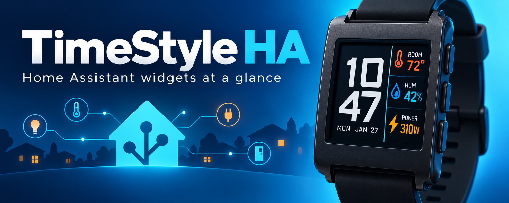
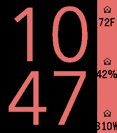
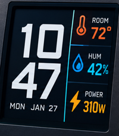

# TimeStyle HA



TimeStyle HA is a Pebble watchface with configurable Home Assistant entity
widgets. It is developed by **ethosoccer** and based on
[TimeStyle](https://github.com/freakified/TimeStylePebble) by Freakified.

The watchface keeps TimeStyle's highly readable clock, themes, health data,
weather, alternate time zones, battery information, and other sidebar widgets.
It adds three Home Assistant widget slots that can display concise states from
any entity exposed by the Home Assistant REST API.

## Home Assistant widgets

Each Home Assistant widget has:

- an entity ID, such as `sensor.living_room_temperature`;
- an optional short label, such as `ROOM` (blank shows the house icon);
- the current entity state; and
- the entity's unit of measurement when available.

Useful examples include temperature, humidity, power usage, device battery,
air quality, door/window state, alarm state, and presence. Values refresh when
the watchface starts, reconnects to the phone, or requests its periodic
30-minute data update.

## Configuration

Open the watchface settings in the Pebble mobile app. Choose **Home Assistant
Entity 1**, **2**, or **3** in a sidebar slot, then enter:

1. the URL that the paired phone can use to reach Home Assistant;
2. a Home Assistant long-lived access token; and
3. up to three entity IDs and short labels.

The Home Assistant URL, token, and entity IDs are stored by the Pebble phone
app. The token is sent only to the configured Home Assistant REST API and is
never included in messages sent to the watch.

## Build

```bash
pebble build
```

The installable package is generated at `build/timestyle-ha.pbw`.

## Preview

| Watchface | Home Assistant concept |
| --- | --- |
|  |  |

## Project identity

This fork uses its own Pebble app UUID and the display name **TimeStyle HA**, so
it can be installed alongside the original TimeStyle watchface.

## License and attribution

MIT licensed. The original TimeStyle copyright and license are preserved in
[`LICENSE`](LICENSE). TimeStyle HA is an independent community project and is
not affiliated with Home Assistant, Nabu Casa, Pebble, or Rebble.
